# Blinkora user guide

Blinkora reminds you to rest your eyes, get up and walk, and drink water while you work at a computer. It counts only the time you are actually working, holds breaks while you are in a call or a fullscreen app, and keeps all of its data on your computer.

Screenshots in this guide come from the real app (Windows 11), run in its built-in demo mode.

## Contents

- [System requirements](#system-requirements)
- [Install](#install)
- [First start](#first-start)
- [How Blinkora decides when to remind you](#how-blinkora-decides-when-to-remind-you)
- [Breaks](#breaks)
- [Tray icon](#tray-icon)
- [Dashboard](#dashboard)
- [Settings](#settings)
- [Running in the background](#running-in-the-background)
- [Updates](#updates)
- [Uninstall](#uninstall)
- [Privacy](#privacy)
- [Troubleshooting and FAQ](#troubleshooting-and-faq)
- [Known limitations](#known-limitations)

## System requirements

| | Windows | Mac |
| --- | --- | --- |
| System | Windows 10 or 11, 64-bit | macOS 10.15 Catalina or later, Intel or Apple Silicon |
| Other | Microsoft Edge WebView2 (built into Windows 11; the installer downloads it if missing) | Keep Safari up to date (at least 14.1 on Catalina) |
| Admin rights | Not needed: installs for the current user only | Not needed |
| Internet | Only for the optional update check | Only for the optional update check |
| Status | Tested | Built, **not yet tested on a real Mac** |

## Install

Download the latest version from the [Releases page](https://github.com/conect2hamza/blinkora-releases/releases/latest).

### Windows

1. Download `Blinkora_<version>_x64-setup.exe`. Use the `.msi` only if your IT department asks for it, and don't install both on the same PC.
2. Run it. Blinkora is not code-signed yet, so Windows SmartScreen may say "Windows protected your PC". Click **More info → Run anyway**. On PCs with **Smart App Control** turned on, Windows blocks unsigned apps entirely.
3. The installer puts Blinkora in `%LOCALAPPDATA%\Blinkora` and starts it.

### Mac

1. Download `Blinkora_<version>_universal.dmg`, open it and drag **Blinkora** into **Applications**.
2. Blinkora is not signed with an Apple Developer ID yet. The first time, right-click Blinkora in Applications and choose **Open → Open**. On macOS 15 or later, open **System Settings → Privacy & Security** and click **Open Anyway**. You only have to do this once.

## First start

A four-step setup opens the first time:

| Step | What you choose |
| --- | --- |
| 1. Make it yours | Theme (System, Light, Dark) and one of 9 colour themes |
| 2. Pick a rhythm | Gentle, Balanced (recommended) or Strict, and whether you want water breaks |
| 3. When do you work? | Your work hours. Blinkora stays silent outside them |
| 4. Start at login | Start Blinkora automatically when you log in |

| | |
| --- | --- |
| 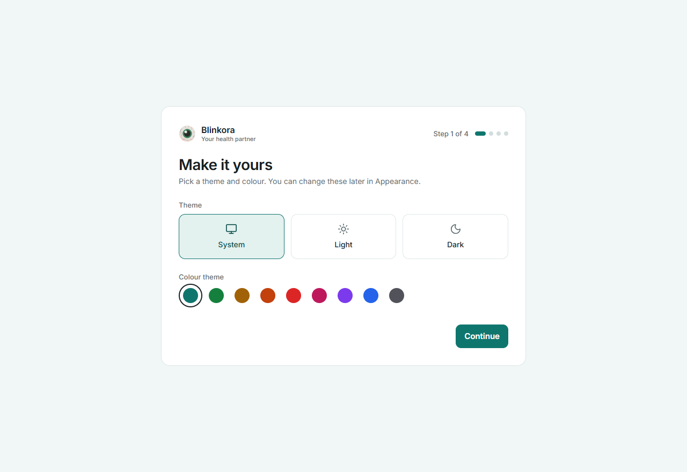 | 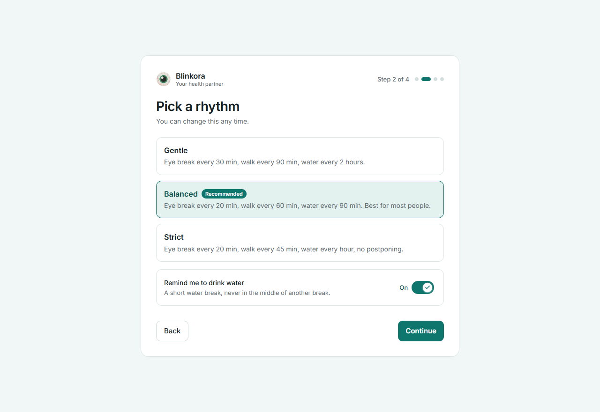 |
| 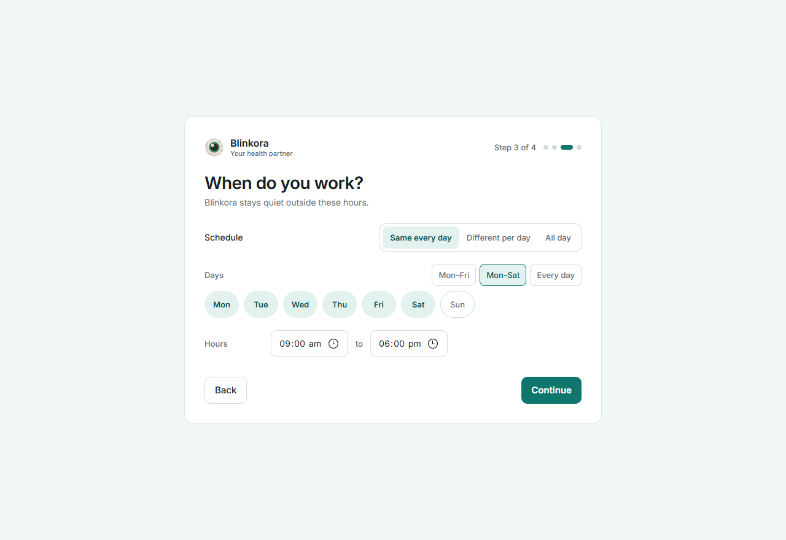 | 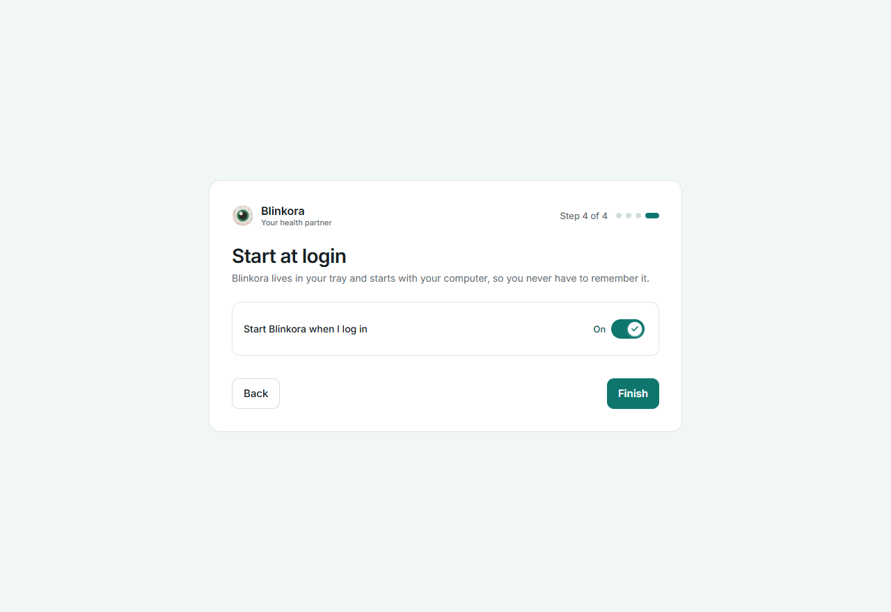 |

After **Finish**, the setup window closes and Blinkora lives in the system tray (the menu bar on Mac).

### Rhythms

| Rhythm | Eye break | Walk break | Water break | Postpone |
| --- | --- | --- | --- | --- |
| Gentle | every 30 min, 30 s | every 90 min, 2 min | every 2 h, 2 min | up to 2 in a row |
| **Balanced** (default) | every 20 min, 30 s | every 60 min, 2 min | every 90 min, 2 min | up to 2 in a row |
| Strict | every 20 min, 30 s | every 45 min, 2 min | every 60 min, 2 min | not allowed |

All intervals count **active** time only, and you can fine-tune every value later under **Breaks**.

## How Blinkora decides when to remind you

- **Only active time counts.** If there is no mouse or keyboard input for 3 minutes (adjustable), Blinkora treats you as away and the timers stop. Reading without touching the mouse for a minute or two still counts as work.
- **Being away counts as a break.** After 3 minutes away, the eye break counts as taken. If you're away for at least the walk break's length, the walk break counts too. Being away never counts as a water break.
- **Breaks don't pile up.** If a longer break is due within 5 minutes of a shorter one, only the longer one appears: a walk covers a water or eye break, and a water break covers an eye break.
- **Smart pause.** While you're in a call, presenting, or using a fullscreen app, game or video, a due break waits. It shows 30 seconds after you're free. If it has waited 30 minutes, it turns into a quiet "Take a break when you can" notification instead.
- **Work hours.** Outside your work hours Blinkora is silent and its timers are frozen.

## Breaks

### Heads-up card

By default, a small card appears in the corner 60 seconds before a break. It never takes the keyboard focus away from what you're typing.

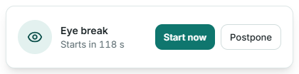

- **Start now** starts the break immediately.
- **Postpone** moves the break 5 minutes later. You can postpone up to 2 times in a row by default; after that, only Start now and Skip remain.

### The break screen

The break screen covers every monitor. On Windows the background is a blurred image of your desktop, which is kept in memory only and never saved. The screenshots below show the plain background used when no image is available.

| Eye break | Walk break | Water break |
| --- | --- | --- |
| 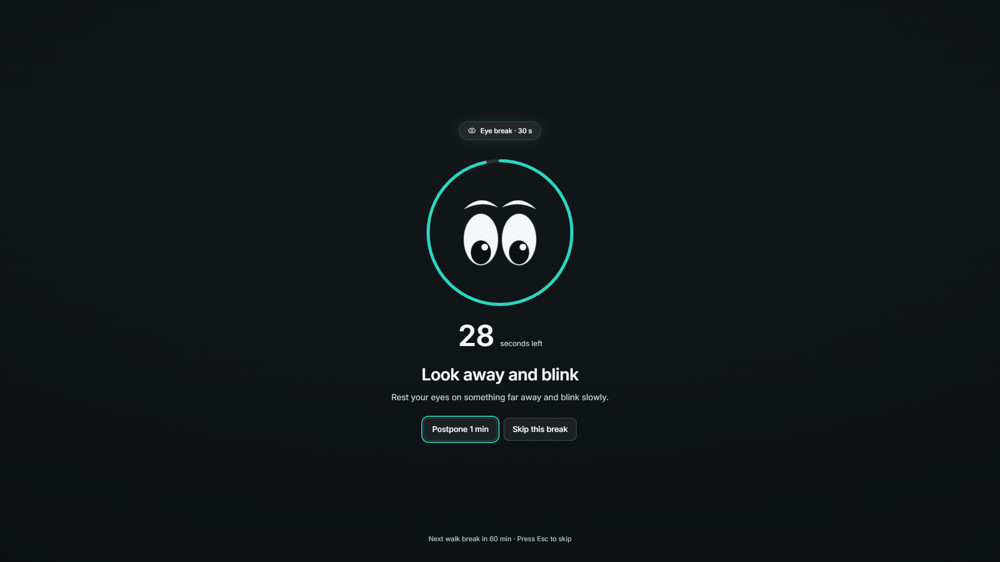 | 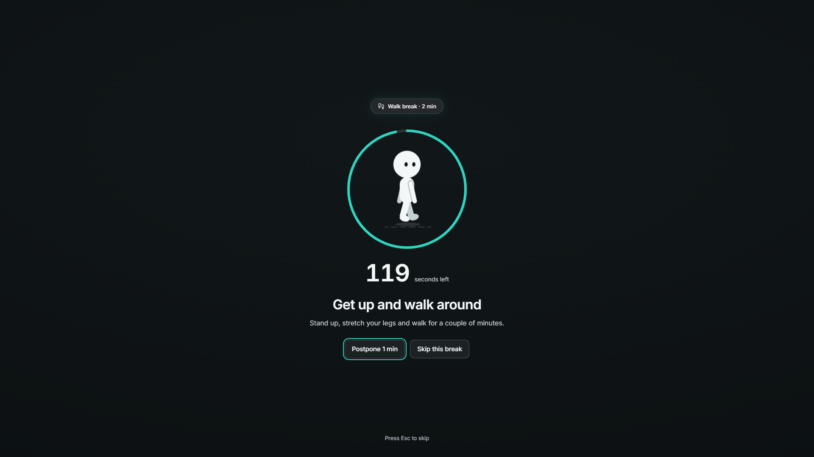 | 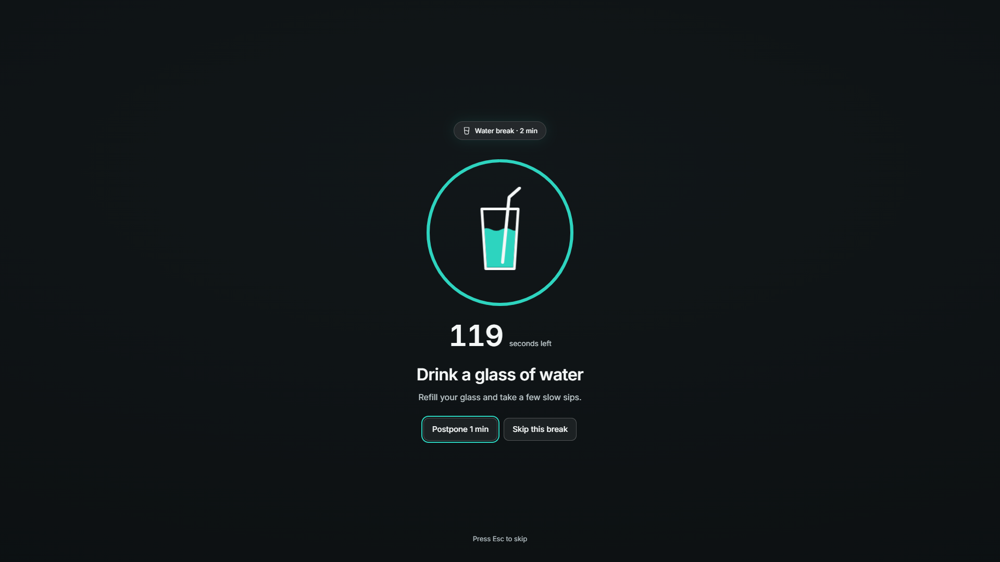 |
| 30 s. Look at something far away and blink | 2 min. Stand up, stretch and walk | 2 min. Drink a glass of water |
| Cartoon eyes look down, left, right and up, lift their brows and blink | A round-headed character walks along a moving floor | A glass fills up, then a straw goes in and the water is sipped away |

Each break shows its animation, a countdown in seconds and these buttons:

- **Done, I drank it** (water break only) ends the break straight away and counts it as taken.
- **Postpone 1 min**, while postpones are left.
- **Skip this break**, or press **Esc**.
- In **Strict mode**, Skip is locked for the first half of the break.
- After 3 skips in a row, a quiet reminder line appears.
- When a break completes, a soft chime plays (you can turn it off under **Appearance**).

## Tray icon

Click the Blinkora icon in the system tray (Windows) or menu bar (Mac):

| Running | Paused |
| --- | --- |
| 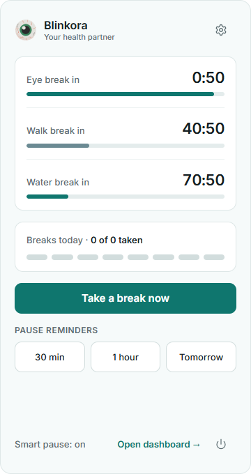 | 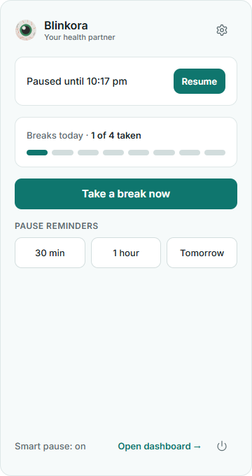 |

- Time left until the next eye, walk and water break.
- Today's breaks taken.
- **Take a break now**.
- **Pause reminders** for 30 min, 1 hour, or until the start of tomorrow's work hours. **Resume** ends the pause early.
- **Open dashboard →**, and the power icon to **quit**.

Right-clicking the icon opens a menu with the same actions.

The shortcut **Ctrl+Alt+B** (Mac: **Cmd+Alt+B**) starts a break from anywhere. You can change it under **Breaks**.

## Dashboard

Open it from the tray. The sidebar holds Today, Stats, Breaks, Smart pause, Appearance, Privacy & data, and **Check for updates**.

### Today

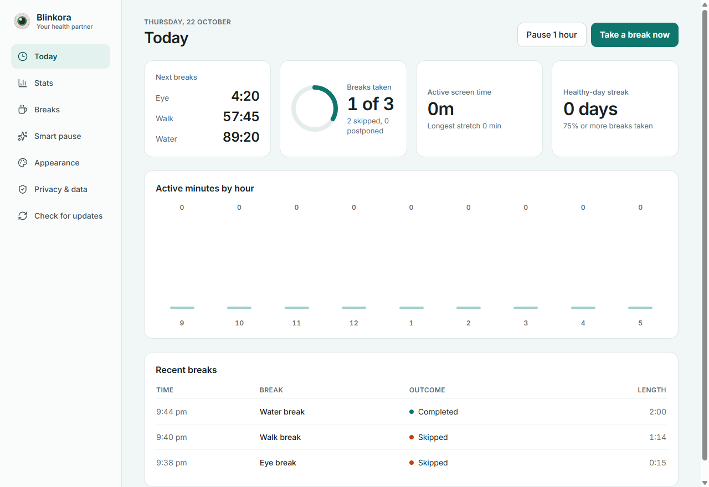

- Time until the next break of each kind.
- Breaks taken today and how many were skipped or postponed.
- Active screen time.
- Your healthy-day streak: a day counts when you take at least 75% of your breaks.
- Active minutes per hour and a list of recent breaks.

*(These screenshots were taken in demo mode, which doesn't record screen time, so it shows 0m.)*

Dark theme:

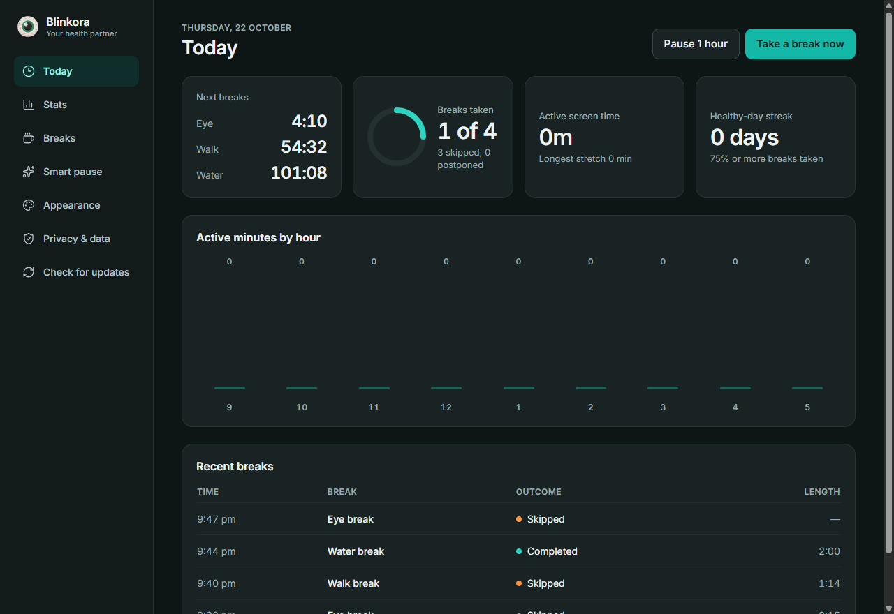

### Stats

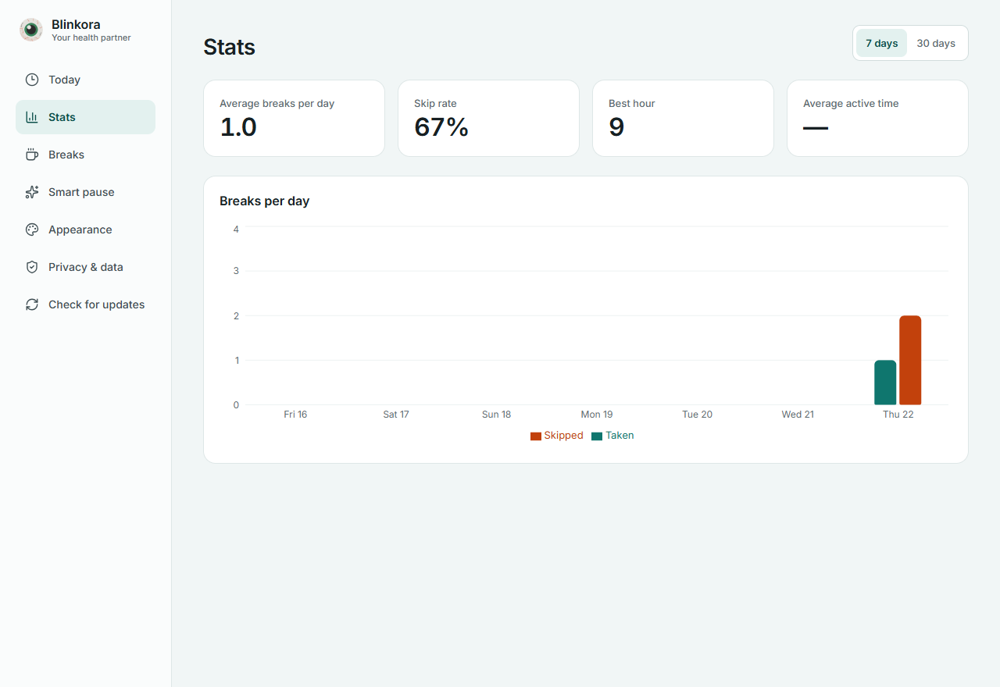

- Breaks taken and skipped per day for the last 7 or 30 days.
- Average breaks per day, skip rate, the hour you most often take breaks, and average active time.

## Settings

Every change is saved immediately; a short "Saved" message confirms it.

### Breaks

| | |
| --- | --- |
| 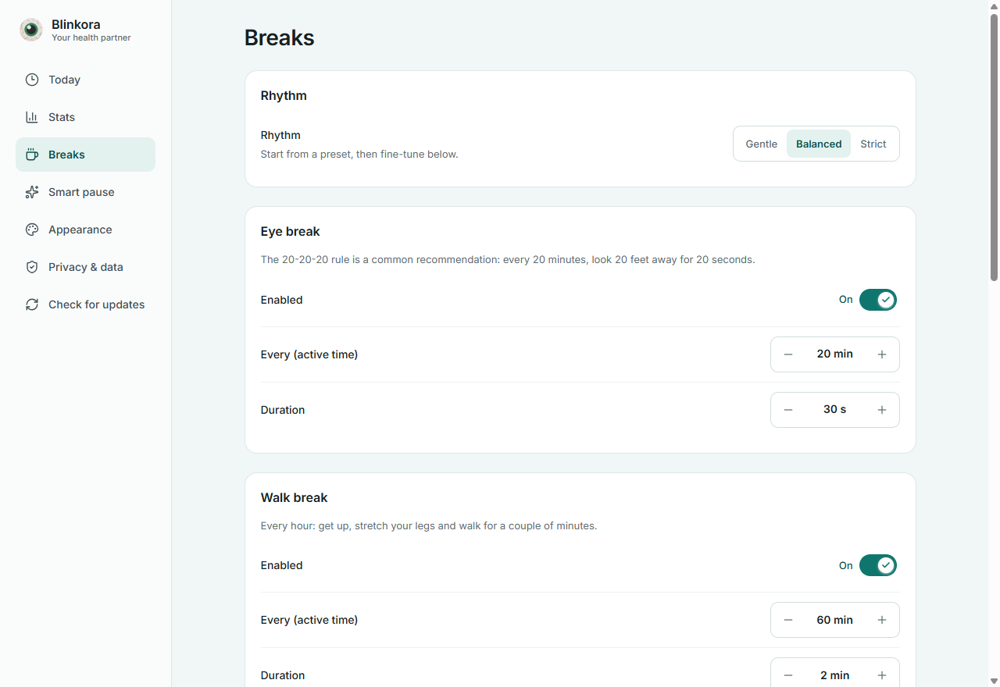 | 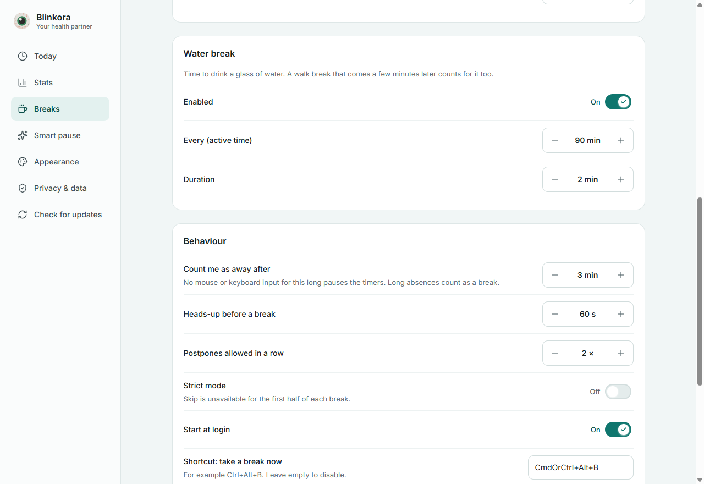 |

| Setting | Range | Default |
| --- | --- | --- |
| Rhythm | Gentle / Balanced / Strict | Balanced |
| Eye break: on/off, every, duration | 5–60 min, 10–120 s | on, 20 min, 30 s |
| Walk break: on/off, every, duration | 20–180 min, 1–15 min | on, 60 min, 2 min |
| Water break: on/off, every, duration | 15–180 min, 1–10 min | on, 90 min, 2 min |
| Count me as away after | 1–15 min | 3 min |
| Heads-up before a break | 0–120 s | 60 s |
| Postpones allowed in a row | 0–5 | 2 |
| Strict mode (no Skip during the first half) | on/off | off |
| Start at login | on/off | on |
| Shortcut: take a break now | any key combination, or empty to turn it off | Ctrl/Cmd+Alt+B |
| Work hours | same every day, different per day, or all day; overnight shifts allowed | Mon–Sat 09:00–18:00 |

### Smart pause

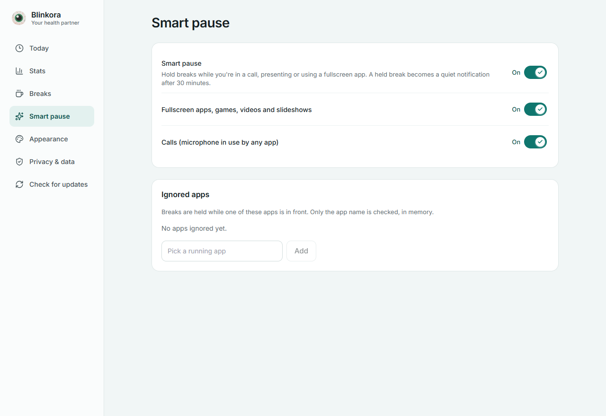

- Turn smart pause on or off.
- Choose whether **fullscreen apps, games, videos and slideshows** and **calls** (any app using the microphone) hold breaks.
- **Ignored apps:** pick running apps (for example a video-call app) that should hold breaks while they're in front. Only the app's name is checked, in memory.

### Appearance

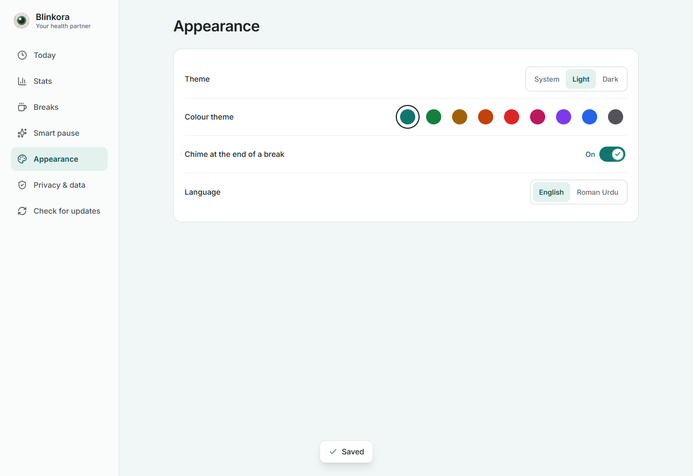

Theme (System, Light, Dark), colour theme, the chime at the end of a break, and the language (English or Roman Urdu).

### Privacy & data

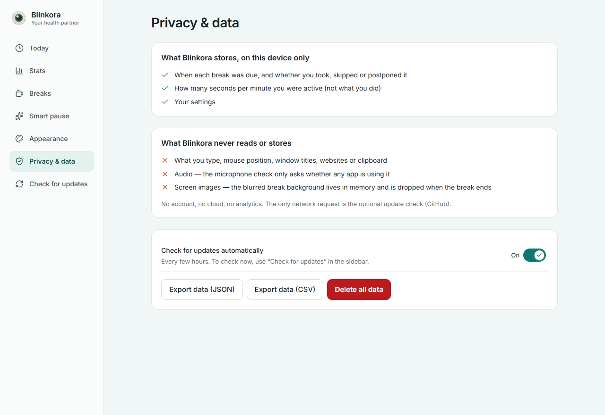

- Lists what Blinkora stores and what it never reads.
- **Check for updates automatically**, on or off.
- **Export data** as JSON or CSV to a file you choose.
- **Delete all data** removes your break history and activity, including the backup copies Blinkora makes before an update changes its database, but keeps your settings. It always asks first:

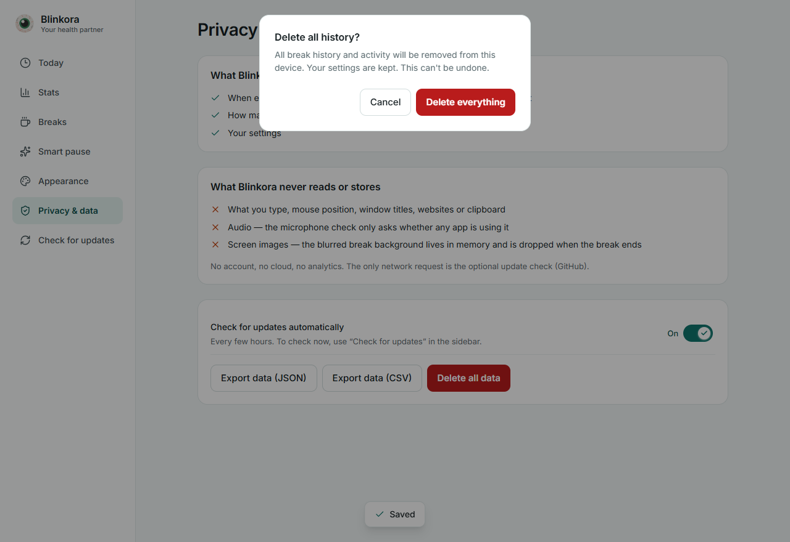

## Running in the background

- Closing the dashboard does **not** stop Blinkora. It keeps running in the tray and reminders continue.
- To stop it completely, use **Quit** (the power icon in the tray popover, or **Quit Blinkora** in the right-click menu).
- With **Start at login** on, Blinkora starts by itself when you log in.
- Opening Blinkora again while it's already running just brings up the dashboard; it never starts a second copy.

## Updates

- **Windows:** Blinkora checks for a new version 1 minute after it starts and every 6 hours after that, unless you turn this off under **Privacy & data**. When an update is available you'll see a notification and an "Update available" banner. **Install & restart** downloads it, checks its signature, installs it and restarts Blinkora.
- **Check now:** click **Check for updates** in the dashboard sidebar. A popup lists **What's new** in the new version, with **Install & restart** and **Later**. If you're already up to date, it says so.

  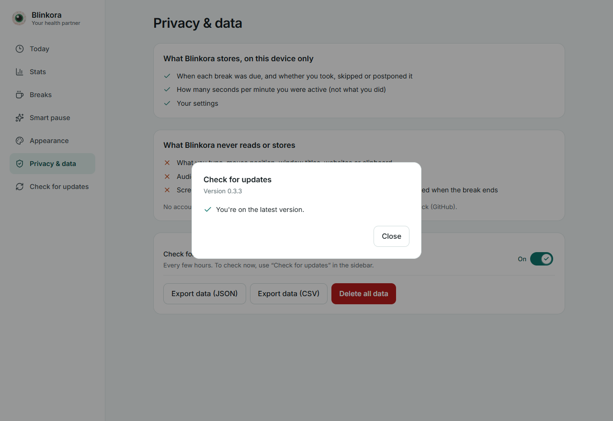

- **Mac:** Blinkora does not update itself on Mac yet. Download the new `.dmg` from the Releases page and replace the app in Applications.

## Uninstall

**Windows:**
- Open **Settings → Apps → Installed apps**, find **Blinkora** and choose **Uninstall**, or run `%LOCALAPPDATA%\Blinkora\uninstall.exe`.
- Your history and settings live in `%APPDATA%\com.blinkora.app` and the logs in `%LOCALAPPDATA%\com.blinkora.app`. Delete both folders if you want to remove everything.

**Mac:**
- Quit Blinkora from the menu bar and move it from Applications to the Bin.
- To remove your data too, delete `~/Library/Application Support/com.blinkora.app`.

## Privacy

What the app does, as written in its code and shown on its **Privacy & data** page:

- **Stored, on this device only:**
  - When each break was due, and whether you took, skipped or postponed it.
  - How many seconds per minute you were active.
  - Your settings.
- **Kept for:** break history and daily totals are deleted after 90 days, activity after 30 days.
- **Never read or stored:** what you type, mouse position, window titles, websites, clipboard or audio. The microphone check only asks whether *any* app is using the microphone.
- **Break background (Windows):** the blurred image of your screen exists only in memory while the break is open.
- **Network:** no account, no cloud, no analytics. The only network request is the optional update check against GitHub, and updates are only installed if their signature matches.

## Troubleshooting and FAQ

**Windows says "Windows protected your PC".**
The app isn't code-signed yet. Click **More info → Run anyway**. With Smart App Control on, Windows won't run it at all.

**macOS says the app "can't be opened" or "the developer cannot be verified".**
Right-click Blinkora in Applications → **Open → Open**. On macOS 15+, use **System Settings → Privacy & Security → Open Anyway**.

**A break didn't appear when I expected it.**
Breaks count *active* time only. They also wait while you're away, outside your work hours, in a call, or in a fullscreen app. The tray shows exactly how long is left.

**Blinkora doesn't start when I log in, even though "Start at login" is on.**
Something removed Blinkora's login entry, for example a cleanup tool or Windows Security. Turn **Start at login** on again under **Breaks**. Since version 0.3.8 Blinkora shows the setting as off when the entry is missing instead of quietly putting it back. If you switched Blinkora off under **Task Manager → Startup apps**, switch it back on there; Blinkora respects that choice.

**Windows Security removed Blinkora ("Trojan:Win32/Bearfoos.A!ml" or "contains a virus").**
This is a false alarm: Microsoft's automatic guess about a new program that isn't code-signed yet. Open **Windows Security → Virus & threat protection → Protection history**, open the Blinkora entry and choose **Actions → Allow on device**, then run the Blinkora setup file again. Your settings and history are kept. Turn **Start at login** on again under **Breaks** if you want it.

**A break screen won't go away.**
Press **Esc** or click **Skip this break**. If that doesn't help, **Quit** Blinkora from the tray and start it again.

**Where are the logs?**
`%LOCALAPPDATA%\com.blinkora.app\logs` on Windows. Logs never contain what you type or what's on screen.

## Known limitations

- **Unsigned installers:** Windows SmartScreen and macOS Gatekeeper warn on first install.
- **Mac version untested:** it hasn't been tested on a real Mac yet, and it doesn't auto-update.
- **"Best hour" on Stats** shows the hour without am/pm, so 9 pm appears as "9".
- **No licence chosen yet.**
